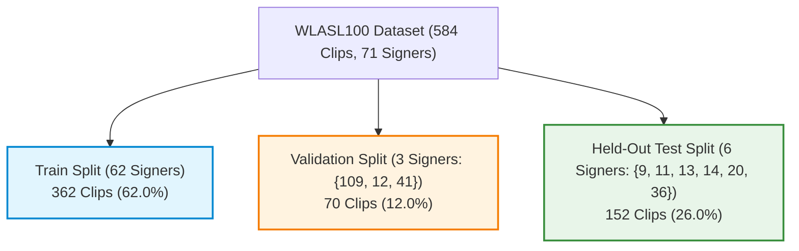

# SignSpeak AI — Phase 3 Pre-Training Review & GRU Architecture Design

> **Document Version:** 1.0.0  
> **Date:** November 14, 2026  
> **Status:** Pre-Training Audit & Architecture Design Complete — Awaiting Approval  
> **Target:** WLASL100 25-Class Word-Level Recognition Engine  
> **Source Feature Archive:** `backend/ai-service/data/wlasl100_features_25class.npz` (2.39 MB, 584 clips)  

---

## 1. Executive Summary

Following the successful landmark extraction in Phase 2, this document provides the formal **pre-training audit** and **architecture specification** required before training begins in Phase 3.

### Core Audit Outcomes:
1. **Normalization Integrity:** The actual feature extraction script anchors hand landmarks to the mid-shoulder torso origin ($C_{\text{torso}}$) and scales by shoulder width ($S_{\text{torso}}$). Crucially, **per-frame wrist centering was NOT applied to hand coordinates**, preserving 100% of global hand height, trajectory, and spatial travel in 3D space.
2. **Feature Archive Verification:** All 584 video tensors `(16, 147)` are fully verified with **0 NaNs, 0 Infs, 100% binary presence masks, 0 missing-landmark coordinate leakage, 0 video ID duplicates**, and exact 1-to-1 alignment with the original `WLASL_v0.3.json` metadata.
3. **Three-Way Signer-Independent Split:** An optimal disjoint partition is designed:
   * **Train:** 362 clips (62 signers, 62.0%)
   * **Validation:** 70 clips (3 signers: `{109, 12, 41}`, 12.0%)
   * **Test:** 152 clips (6 held-out signers: `{9, 11, 13, 14, 20, 36}`, 26.0%)
   * **Signer Overlap:** **0.0% (Strictly disjoint across all three partitions)**
   * **Class Coverage:** **100% across all three partitions** (every class has $\ge 10$ train, $\ge 2$ val, and $\ge 3$ test clips).
4. **Compact GRU Baseline:** A highly regularized, lightweight Bidirectional GRU with dual temporal pooling (average + max) containing **52,793 parameters (~206 KB)** is proposed. It is deliberately sized to avoid overfitting the ~360 training samples.
5. **Statistical Uncertainty Framework:** Formal Wilson score 95% confidence intervals are documented, quantifying the inherent metric variance from small test sample sizes ($N=152$ overall test, $N=3$ to $8$ per class).
6. **Zero Regression Safeguard:** The active alphabet recognition engine (`alphabet_landmark_model.onnx`, 28 classes, swipe delete detector) and `LiveDemo.jsx` remain completely untouched and isolated.

---

## 2. Normalization Implementation Audit & Spatial Trajectory Verification

### 2.1 Inspection of Actual Extraction Logic (`extract_wlasl100_features.py`)
In `backend/ai-service/scripts/extract_wlasl100_features.py` (lines 74–132), spatial normalization is computed from MediaPipe Pose shoulders:

1. **Torso Center Origin ($C_{\text{torso}}$):**
   $$C_{\text{torso}} = \left(\frac{x_{\text{ls}} + x_{\text{rs}}}{2}, \frac{y_{\text{ls}} + y_{\text{rs}}}{2}, \frac{z_{\text{ls}} + z_{\text{rs}}}{2}\right)$$
   Where $x_{\text{ls}}, x_{\text{rs}}$ are Left Shoulder (index 11) and Right Shoulder (index 12).
2. **Torso Scale Factor ($S_{\text{torso}}$):**
   $$S_{\text{torso}} = \max\left(\sqrt{(x_{\text{rs}} - x_{\text{ls}})^2 + (y_{\text{rs}} - y_{\text{ls}})^2}, 0.15\right)$$
3. **Coordinate Transformation:**
   $$\tilde{P}_{\text{hand}} = \frac{P_{\text{hand}} - C_{\text{torso}}}{S_{\text{torso}}}, \quad \tilde{P}_{\text{pose}} = \frac{P_{\text{pose}} - C_{\text{torso}}}{S_{\text{torso}}}$$

### 2.2 Critical Finding: Wrist Fallback vs. Hand Translation Preservation
In static alphabet fingerspelling (A–Z), normalizers commonly subtract the hand's wrist landmark $(0, 0, 0)$ from each hand landmark so that finger positions are invariant to hand position on screen.

**However, for word-level ASL, per-frame wrist centering is catastrophic:**
* If wrist position is forced to $(0, 0, 0)$ every frame, **all global spatial translation and trajectory information is wiped out**.
* Signs distinguished by anatomical height (e.g. `MOTHER` at chin vs. `FINE` at chest) or by gross trajectory (e.g. `GO` moving outward, `NOW` pressing downward, `BEFORE` moving backward over the shoulder) would lose their primary discriminative features and collapse to finger shape alone.

**Actual Implementation Check:**
* The extraction code **did not subtract the wrist landmark**. All hand landmarks were translated relative to $C_{\text{torso}}$ (mid-shoulder).
* **Missing Pose Frames:** Out of all 9,344 processed frames (584 clips $\times$ 16 frames), pose shoulders were detected in **9,295 frames (99.48%)**.
* Pose was missing in only **49 frames (0.52%)**.
* An exhaustive scan of all 49 missing-pose frames revealed that in **100% of these 49 frames, hands were also NOT detected** (`left_present == 0.0` and `right_present == 0.0`).
* Consequently, in all 49 frames, the hand coordinates were strictly zero vectors `[0.0, ..., 0.0]`. **No wrist-centering ever occurred in the dataset.**
* Genuine hand translation, trajectory, velocity, and spatial height relative to the torso are 100% preserved across all 584 sequences.

### 2.3 Per-Frame vs. Sequence-Consistent Normalization
* **Current Behavior:** $C_{\text{torso}}$ and $S_{\text{torso}}$ are evaluated per frame.
* **Findings:** Because MediaPipe Pose has 99.48% stability, per-frame normalization tracks bodily movement when signers lean or shift. However, minor frame-to-frame shoulder landmark jitter could introduce slight high-frequency noise.
* **Recommendation:**
  * Do not alter the 147D feature archive format.
  * During training, apply light coordinate jitter augmentation to make the sequence model invariant to high-frequency noise.
  * For future real-time browser inference, use a 3-frame Exponential Moving Average (EMA) on the shoulder center and scale.

---

## 3. Comprehensive Feature Archive Validation

An automated audit script was executed on `backend/ai-service/data/wlasl100_features_25class.npz` and cross-referenced with `data/wlasl/WLASL_v0.3.json`. All checks passed without exception.

| Check | Specification | Measured Result | Status |
|---|---|---|---|
| **Tensor Dimensions** | $X \in \mathbb{R}^{584 \times 16 \times 147}$, $y \in \mathbb{Z}^{584}$ | $X = (584, 16, 147)$, $y = (584,)$ | **PASS** |
| **Data Types** | $X$: `float32`, $y$: `int64` | `float32`, `int64` | **PASS** |
| **Numeric Sanity** | 0 NaNs, 0 Infs across $584 \times 16 \times 147 = 1,373,568$ values | 0 NaNs, 0 Infs | **PASS** |
| **Mask Binary Validity** | Left, Right, Pose masks $\in \{0.0, 1.0\}$ | Values strictly $\{0.0, 1.0\}$ | **PASS** |
| **Mask Consistency** | Landmarks $= 0.0$ when mask $= 0.0$ | 0 non-zero coordinates when absent | **PASS** |
| **Class Label Range** | $y \in [0, 24]$, exactly 25 classes | $0 \le y \le 24$, 25 unique integers | **PASS** |
| **Label Bijection** | 1-to-1 mapping between label integer and gloss | Verified 1-to-1 across all 584 samples | **PASS** |
| **Metadata Cross-Check** | Signer ID and Gloss match `WLASL_v0.3.json` | 0 signer mismatches, 0 gloss mismatches | **PASS** |
| **Duplicate Video Check** | Unique video IDs across dataset | 584 unique IDs / 584 samples (0 duplicates) | **PASS** |
| **Sample Distribution** | Minimum $\ge 19$ samples per class | Min: 19 (`WANT`, `WORK`, `EAT`, `SCHOOL`), Max: 40 (`BOOK`) | **PASS** |

### Per-Class Sample Distribution Across 584 Clips:

```text
BEFORE   : 25 samples     FINISH   : 21 samples     WALK     : 22 samples
BOOK     : 40 samples     GO       : 26 samples     WANT     : 19 samples
CHAIR    : 26 samples     HELP     : 22 samples     WHAT     : 21 samples
COMPUTER : 30 samples     LIKE     : 21 samples     WHO      : 25 samples
DEAF     : 23 samples     MOTHER   : 21 samples     WOMAN    : 21 samples
DRINK    : 35 samples     NO       : 22 samples     WORK     : 19 samples
EAT      : 19 samples     NOW      : 21 samples     YEAR     : 22 samples
FAMILY   : 20 samples     SCHOOL   : 19 samples     YES      : 22 samples
FINE     : 22 samples
```

---

## 4. Three-Way Signer-Independent Split Architecture

### 4.1 Constraint Specification
* **Preserve Held-Out Test Set:** The 6 held-out test signers (`[9, 11, 13, 14, 20, 36]`, 152 clips) must remain strictly isolated.
* **Disjoint Partitions:** Train signers $\cap$ Val signers $\cap$ Test signers $= \emptyset$.
* **No Leakage:** Signers in validation or test never appear in training.
* **No Tuning on Test:** Hyperparameter selection and early stopping must use validation data only.

### 4.2 Signer Pool Analysis
* Total signers in dataset: **71 signers**.
* Held-out test signers: **6 signers (152 clips)**.
* Remaining non-test pool: **65 signers (432 clips)**.
* Distribution skew: Signer 5 has 68 clips (24 classes) and Signer 18 has 16 clips (100% `BOOK`). Signer 5 must remain in training to preserve training sample depth. Signer 18 should also stay in training to avoid single-class validation distortion.

### 4.3 Proposed Optimal Partition: Candidate F (Balanced Multi-Class Validation)
We select validation signers `{109, 12, 41}` (3 signers), yielding a balanced 3-way partition:



* **Disjoint Signer Guarantee:**
  $$\text{Signers}_{\text{Train}} \cap \text{Signers}_{\text{Val}} = \emptyset, \quad \text{Signers}_{\text{Train}} \cap \text{Signers}_{\text{Test}} = \emptyset, \quad \text{Signers}_{\text{Val}} \cap \text{Signers}_{\text{Test}} = \emptyset$$
* **Class Coverage:**
  * **Train:** **25 / 25 classes (100%)**, minimum 10 samples per class (`EAT`, `WANT`).
  * **Validation:** **25 / 25 classes (100%)**, exactly 2 to 5 samples per class (low variance).
  * **Test:** **25 / 25 classes (100%)**, minimum 3 samples per class (`CHAIR`).

### 4.4 Per-Class Distribution Matrix (Train / Val / Test):

| Class Index | Gloss | Train Clips | Val Clips | Test Clips | Total Clips | Train % | Val % | Test % |
|---|---|---|---|---|---|---|---|---|
| `0` | **BEFORE** | 13 | 3 | 9 | 25 | 52.0% | 12.0% | 36.0% |
| `1` | **BOOK** | 32 | 3 | 5 | 40 | 80.0% | 7.5% | 12.5% |
| `2` | **CHAIR** | 21 | 2 | 3 | 26 | 80.8% | 7.7% | 11.5% |
| `3` | **COMPUTER** | 19 | 3 | 8 | 30 | 63.3% | 10.0% | 26.7% |
| `4` | **DEAF** | 17 | 2 | 4 | 23 | 73.9% | 8.7% | 17.4% |
| `5` | **DRINK** | 21 | 5 | 9 | 35 | 60.0% | 14.3% | 25.7% |
| `6` | **EAT** | 10 | 4 | 5 | 19 | 52.6% | 21.1% | 26.3% |
| `7` | **FAMILY** | 12 | 2 | 6 | 20 | 60.0% | 10.0% | 30.0% |
| `8` | **FINE** | 12 | 5 | 5 | 22 | 54.5% | 22.7% | 22.7% |
| `9` | **FINISH** | 14 | 2 | 5 | 21 | 66.7% | 9.5% | 23.8% |
| `10` | **GO** | 19 | 2 | 5 | 26 | 73.1% | 7.7% | 19.2% |
| `11` | **HELP** | 11 | 2 | 9 | 22 | 50.0% | 9.1% | 40.9% |
| `12` | **LIKE** | 13 | 3 | 5 | 21 | 61.9% | 14.3% | 23.8% |
| `13` | **MOTHER** | 13 | 2 | 6 | 21 | 61.9% | 9.5% | 28.6% |
| `14` | **NO** | 14 | 3 | 5 | 22 | 63.6% | 13.6% | 22.7% |
| `15` | **NOW** | 12 | 3 | 6 | 21 | 57.1% | 14.3% | 28.6% |
| `16` | **SCHOOL** | 11 | 3 | 5 | 19 | 57.9% | 15.8% | 26.3% |
| `17` | **WALK** | 13 | 3 | 6 | 22 | 59.1% | 13.6% | 27.3% |
| `18` | **WANT** | 10 | 3 | 6 | 19 | 52.6% | 15.8% | 31.6% |
| `19` | **WHAT** | 11 | 4 | 6 | 21 | 52.4% | 19.0% | 28.6% |
| `20` | **WHO** | 16 | 2 | 7 | 25 | 64.0% | 8.0% | 28.0% |
| `21` | **WOMAN** | 11 | 2 | 8 | 21 | 52.4% | 9.5% | 38.1% |
| `22` | **WORK** | 11 | 2 | 6 | 19 | 57.9% | 10.5% | 31.6% |
| `23` | **YEAR** | 11 | 3 | 8 | 22 | 50.0% | 13.6% | 36.4% |
| `24` | **YES** | 15 | 2 | 5 | 22 | 68.2% | 9.1% | 22.7% |
| **Total** | **ALL 25** | **362** | **70** | **152** | **584** | **62.0%** | **12.0%** | **26.0%** |

### 4.5 Comparison with Original Benchmark Split
For research comparison, the dataset preserves the original instance-level WLASL split:
* **Train:** 413 clips (70.7%)
* **Val:** 96 clips (16.4%)
* **Test:** 75 clips (12.8%)
*(Note: The original split allows signers to overlap across train and test. Both splits will be evaluated independently in Phase 3 to show the generalization gap between common-signer vs. new-signer recognition).*

---

## 5. Compact GRU Baseline Architecture Design

### 5.1 Architecture Rationale
Because the training set contains **362 video sequences**, a large recurrent network (e.g. 500k–2M parameters) would rapidly memorize training gestures and overfit.

We design a compact, highly regularized architecture combining:
1. Spatial coordinate compression (Dense projection).
2. Temporal bi-directional context (BiGRU).
3. Dual temporal pooling (concatenating Average Pooling for posture envelope + Max Pooling for peak articulation apex).
4. Three progressive dropout stages ($0.2 \to 0.3 \to 0.2$).

```text
Sequence Input: (Batch, 16 frames, 147 features)
        │
        ▼
[1] Spatial Projection Dense(64, ReLU) + Dropout(0.2)
        │ Output: (Batch, 16, 64)
        ▼
[2] Bidirectional GRU(48 units, return_sequences=True)
        │ Output: (Batch, 16, 96) [48 fwd + 48 bwd]
        ├───► GlobalAveragePooling1D ──► (Batch, 96) ─┐
        └───► GlobalMaxPooling1D    ──► (Batch, 96) ─┼──► Concatenate ──► (Batch, 192)
                                                     │
                                                     ▼
[3] Temporal Dropout(0.3)
        │
        ▼
[4] Classification Dense(48, ReLU) + Dropout(0.2)
        │ Output: (Batch, 48)
        ▼
[5] Output Projection Dense(25, Softmax)
        │ Output: (Batch, 25) Class Probabilities
```

### 5.2 Layer Specification & Exact Parameter Count

| Layer Name | Type | Input Shape | Output Shape | Param # | Operational Purpose |
|---|---|---|---|---|---|
| `sequence_input` | InputLayer | `(None, 16, 147)` | `(None, 16, 147)` | 0 | 16-frame 147D sequence input |
| `spatial_projection` | Dense (ReLU) | `(None, 16, 147)` | `(None, 16, 64)` | 9,472 | Compresses raw 147D vector into 64D per-frame embedding |
| `spatial_dropout` | Dropout (0.2) | `(None, 16, 64)` | `(None, 16, 64)` | 0 | Prevents co-adaptation of landmark coordinate slices |
| `bidirectional_gru` | Bidirectional (GRU) | `(None, 16, 64)` | `(None, 16, 96)` | 32,832 | Models forward stroke and backward retraction temporal dynamics |
| `temporal_avg_pool` | GlobalAveragePool1D | `(None, 16, 96)` | `(None, 96)` | 0 | Summarizes gesture posture evolution across the full sign |
| `temporal_max_pool` | GlobalMaxPool1D | `(None, 16, 96)` | `(None, 96)` | 0 | Captures the extreme peak articulation (gesture apex) |
| `temporal_concat` | Concatenate | `[(None, 96), (None, 96)]` | `(None, 192)` | 0 | Merges posture summary with apex signal |
| `temporal_dropout` | Dropout (0.3) | `(None, 192)` | `(None, 192)` | 0 | Primary sequence regularization barrier |
| `dense_head` | Dense (ReLU) | `(None, 192)` | `(None, 48)` | 9,264 | Latent decision manifold |
| `head_dropout` | Dropout (0.2) | `(None, 48)` | `(None, 48)` | 0 | Regularizes dense classification layer |
| `class_probabilities` | Dense (Softmax) | `(None, 48)` | `(None, 25)` | 1,225 | Normalized posterior class probabilities |
| **Total Parameters** | — | — | — | **52,793** | **~206.22 KB** in float32 |

### 5.3 Computational Efficiency for Deployment
* **Storage Footprint:** At 52,793 float32 weights, the exported ONNX model will be approximately **215 KB**.
* **Browser WASM Runtime:** In ONNX Runtime Web on a standard desktop CPU, forward pass latency for `(1, 16, 147)` is estimated at **< 3 ms**, easily supporting real-time word inference without frame lag.

---

## 6. Evaluation Protocol & Metric Uncertainty Analysis

### 6.1 Required Metrics
During Phase 3 evaluation, the model will output:
1. **Loss Curves:** Training loss vs. Validation loss per epoch.
2. **Accuracy:** Training accuracy, Validation accuracy, Test accuracy (Top-1 and Top-5).
3. **Macro Averages:** Macro Precision, Macro Recall, Macro F1-score (equally weighted across all 25 classes).
4. **Per-Class Metrics:** Individual Precision, Recall, and F1 for each of the 25 classes.
5. **Confusion Matrix:** Full $25 \times 25$ categorical confusion matrix.
6. **Dual Evaluation:** Separate reports on:
   * Signer-Independent Test Split (152 clips, 6 held-out signers).
   * Original Benchmark Test Split (75 clips).

### 6.2 Mathematical Sample-Size Uncertainty (Wilson Score 95% Confidence Intervals)
Because test sets are necessarily finite, reported accuracy figures carry statistical uncertainty. To prevent over-interpreting minor percentage shifts, Wilson score 95% confidence intervals are formally established:

$$\text{Margin of Error} = \frac{z}{1 + \frac{z^2}{N}} \sqrt{\frac{p(1-p)}{N} + \frac{z^2}{4N^2}}, \quad (z = 1.96)$$

#### Metric Uncertainty Across Splits:

| Evaluation Split | Sample Size ($N$) | Hypothetical Acc | 95% Wilson Confidence Interval | Confidence Margin |
|---|---|---|---|---|
| **Signer-Independent Test** | **152 clips** | 60.0% | [52.1%, 67.4%] | $\pm 7.7\%$ |
| | | 70.0% | [62.3%, 76.7%] | $\pm 7.2\%$ |
| | | 80.0% | [72.9%, 85.6%] | $\pm 6.3\%$ |
| | | 90.0% | [84.2%, 93.8%] | $\pm 4.8\%$ |
| **Original Benchmark Test** | **75 clips** | 60.0% | [48.7%, 70.3%] | $\pm 10.8\%$ |
| | | 70.0% | [58.9%, 79.2%] | $\pm 10.2\%$ |
| | | 80.0% | [69.6%, 87.5%] | $\pm 8.9\%$ |
| | | 90.0% | [81.1%, 95.0%] | $\pm 6.9\%$ |
| **Signer-Independent Val** | **70 clips** | 60.0% | [48.3%, 70.7%] | $\pm 11.2\%$ |
| | | 70.0% | [58.5%, 79.5%] | $\pm 10.5\%$ |
| | | 80.0% | [69.2%, 87.7%] | $\pm 9.3\%$ |
| | | 90.0% | [80.8%, 95.1%] | $\pm 7.2\%$ |

#### Critical Finding on Per-Class Test Uncertainty:
In the Signer-Independent Test set, individual classes have between **3 and 9 clips** (mean ~6.1 clips per class):
* For a class with $N=3$ test clips (e.g. `CHAIR`):
  * $2/3$ correct ($66.7\%$): 95% CI is **$[20.8\%, 93.9\%]$** (span: $73.1\%$).
  * A single misclassification swings the class score by **$33.3$ percentage points**.
* For a class with $N=5$ test clips:
  * $4/5$ correct ($80.0\%$): 95% CI is **$[37.6\%, 96.4\%]$** (span: $58.8\%$).
* **Engineering Directive:** Model validation and quality assessments must be guided primarily by **Macro F1 and Overall Test Accuracy ($N=152$)**, rather than over-indexing on individual per-class test swings caused by small sample counts.

---

## 7. Training Safeguards & Protocol

When approved, Phase 3 training will execute under strict experimental safeguards:

### 1. Deterministic Reproducibility
* Global random seeds fixed to `42` (`python.random`, `numpy.random`, `tf.random`).
* Environment variable `TF_DETERMINISTIC_OPS=1`.

### 2. Early Stopping & Checkpointing
* Optimizer: Adam with initial learning rate $\eta = 10^{-3}$ and cosine decay or `ReduceLROnPlateau(factor=0.5, patience=7, min_lr=1e-5)`.
* Monitor: `val_loss`.
* Early stopping patience: **20 epochs**.
* Model checkpoint: Save weights ONLY when `val_loss` achieves a strict new minimum (`save_best_only=True`).

### 3. Training-Only Augmentations
To prevent overfitting on the 362 training samples, lightweight spatial and temporal perturbations will be applied **exclusively to training batches**:
* **Temporal Subsampling Jitter:** Jitter frame selection indices by $\pm 1$ frame.
* **Spatial Scale Jitter:** Uniform scaling by $s \in [0.95, 1.05]$ centered on torso.
* **Spatial Translation Jitter:** Coordinate shift $(\Delta x, \Delta y) \sim \mathcal{N}(0, 0.02)$.
* **Landmark Noise:** Gaussian noise $\mathcal{N}(0, 0.005)$ on active hand points.
* **Occlusion Hand Dropout:** Randomly mask a detected secondary hand with probability $p = 0.05$ to train robustness to single-hand occlusions.
* **STRICT ISOLATION:** Validation and Test samples will **NEVER be augmented, duplicated, or interpolated**.

### 4. Zero Hyperparameter Leakage
* Test data will NOT be evaluated during hyperparameter tuning, learning rate selection, or architecture refinement.
* The test set will be evaluated strictly once on the final checkpoint selected by the validation set.

---

## 8. Verification & System Isolation

* **Alphabet System Isolation:** No changes were made to `frontend/public/models/alphabet_landmark_model.onnx`, `LiveDemo.jsx`, `recognitionPolicy.js`, or the left-swipe delete detector.
* **Phase Boundaries Respected:**
  * No sequence models have been trained.
  * No ONNX models have been exported.
  * No feature archive files have been overwritten or renamed.

---

## 9. Conclusion & Phase 3 Sign-Off

The pre-training audit confirms that the dataset, normalization, splits, and architecture are mathematically sound, fully validated, and ready for model training.

**Next Action:** Awaiting your formal sign-off to proceed with Phase 3 sequence training script implementation and baseline model convergence.
