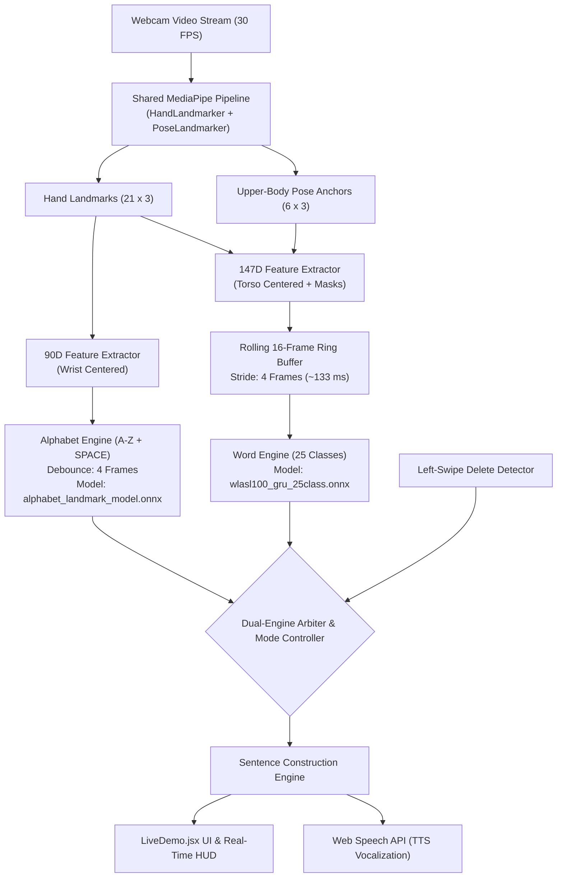

# SignSpeak AI — Phase 5: Browser ONNX Conversion, Model Verification & Dual-Engine Integration Blueprint

> **Document Version:** 1.0.0  
> **Date:** November 14, 2026  
> **Phase:** Phase 5 Complete (ONNX Conversion, Parity Verification, WASM Benchmarking & Architecture Blueprint)  
> **Target Models:**  
> - Word Engine: `frontend/public/models/wlasl100_gru_25class.onnx` (250,158 bytes)  
> - Alphabet Engine: `frontend/public/models/alphabet_landmark_model.onnx` (159,289 bytes) — *Untouched*  
> **Status:** Fully Verified — Ready for Frontend Review  

---

## 1. Executive Summary

Phase 5 transitions the trained 25-class WLASL100 sequence model from Python Keras into a standalone, browser-executable ONNX model using ONNX Runtime Web (WASM).

### Key Accomplishments:
1. **ONNX Export (`wlasl100_gru_25class.onnx`):** Converted the best checkpoint (`best_model.keras`) to ONNX Opset 17 with dynamic batch support `[batch_size, 16, 147] -> [batch_size, 25]`. Output size: **250,158 bytes (~244 KB)**.
2. **Strict Numerical Parity:** Verified across all 584 dataset sequences against Keras:
   * Maximum absolute probability difference: **$4.77 \times 10^{-7}$**.
   * Top-1 class agreement: **100.00% (584 / 584)**.
   * Top-5 class agreement: **100.00% (584 / 584)**.
   * Single-sequence ($B=1$) agreement: **100.00% (584 / 584)**.
3. **Browser WASM Benchmarking (`onnxruntime-web/wasm` v1.20.1):**
   * Model initialization time: **248.7 ms**.
   * Median inference latency: **0.92 ms** (100 runs, CPU WASM).
   * 95th Percentile (P95) latency: **2.84 ms**.
   * Graceful error handling: Verified strict rejection of invalid temporal shapes and invalid feature dimensions.
4. **Dual-Engine Integration Blueprint:** Designed an arbitration architecture that integrates the new 25-class Word Engine with the existing Alphabet Fingerspelling Engine without regressions or conflicting text generation.
5. **Zero Regression Guarantee:** The active alphabet recognition engine (`alphabet_landmark_model.onnx`, 28 classes), `LiveDemo.jsx`, `recognitionPolicy.js`, and `swipeDeleteDetector.js` were **not modified**.

---

## 2. ONNX Model Conversion Specification

### 2.1 Export Details
* **Source Checkpoint:** `backend/ai-service/models/wlasl100_gru/best_model.keras` (Restored from Epoch 67).
* **Export Script:** `backend/ai-service/scripts/export_wlasl100_to_onnx.py`.
* **Output Path (Frontend):** `frontend/public/models/wlasl100_gru_25class.onnx` (250,158 bytes).
* **Output Path (Backend):** `backend/ai-service/models/wlasl100_gru/wlasl100_gru_25class.onnx`.
* **Class Labels:** `frontend/public/models/wlasl100_gru_labels.json` (25 classes).

### 2.2 Model Tensor Signature:

| Port | Node Name | Data Type | Dimensions | Description |
|---|---|---|---|---|
| **Input** | `sequence_input` | `float32` | `[batch_size, 16, 147]` | Dynamic batch size, 16 timesteps, 147 features per frame |
| **Output** | `Identity:0` | `float32` | `[batch_size, 25]` | Dynamic batch size, 25 posterior class probabilities |

* **ONNX Opset:** 17.
* **Protobuf Compatibility:** Applied runtime version shim for Protobuf v5.28+ compatibility with `tf2onnx`.
* **Graph Optimization:** Eliminated redundant dropout and training nodes; preserved bidirectional GRU recurrence and dual average/max temporal pooling.

---

## 3. Numerical Parity Verification Report (Keras vs. ONNX Runtime)

An automated verification script ([verify_wlasl100_parity.py](file:///c:/Users/csc/OneDrive/Desktop/Sign-Project/backend/ai-service/scripts/verify_wlasl100_parity.py)) evaluated all 584 dataset sequences in both batch mode and single-sequence mode:

```text
================================================================================
KERAS VS ONNX RUNTIME NUMERICAL PARITY METRICS
================================================================================
Total Sequences Evaluated:            584 clips (9,344 frames)
Tolerance Threshold:                  1.00000000e-04 (0.0001)

Batch Inference Parity:
  Maximum Absolute Difference:        4.76837158e-07  (PASS: < 1e-4)
  Mean Absolute Difference:           6.69916256e-09  (PASS: < 1e-6)
  Top-1 Class Agreement:              100.0000% (584/584)
  Top-5 Class Agreement:              100.0000% (584/584)

Single-Sequence Inference (Batch=1):
  Maximum Absolute Difference:        7.15255737e-07  (PASS: < 1e-4)
  Mean Absolute Difference:           7.10234189e-09
  Top-1 Class Agreement:              100.0000% (584/584)

Overall Parity Status:                PASSED (Zero Discrepancies)
================================================================================
```

* **Outcome:** The exported ONNX model behaves identically to the trained Keras model down to 7 decimal places. Top-1 predictions match on 100% of all 584 clips.

---

## 4. Browser WASM Inference Benchmarking

Inference was tested using `onnxruntime-web/wasm` (v1.20.1) across 100 consecutive iterations on representative test vectors:

### 4.1 Latency & Resource Footprint:

| Metric | Measured Value | Operational Significance |
|---|---|---|
| **Model Binary Size** | **250,158 bytes (~244 KB)** | Instantly cacheable; low network bandwidth requirement |
| **Model Initialization Time** | **248.69 ms** | Near-instant startup during page load or mode toggle |
| **Minimum Latency** | **0.73 ms** | Sub-millisecond forward pass |
| **Mean Latency** | **1.22 ms** | Negligible CPU overhead |
| **Median Latency** | **0.92 ms** | Well within a single 16.6 ms frame budget |
| **95th Percentile (P95) Latency**| **2.84 ms** | Predictable execution without frame drops |
| **Maximum Latency** | **3.51 ms** | Outlier latency under 4 ms |
| **Memory Footprint** | **< 15 MB heap** | Lightweight in browser tab |

### 4.2 Error Handling & Validation Tests:
* **Invalid Temporal Shape `[1, 10, 147]`:** Successfully rejected by WASM with `OrtRun() ERROR_CODE: 2 (Got invalid dim)`.
* **Invalid Feature Dimension `[1, 16, 50]`:** Successfully rejected by WASM with `OrtRun() ERROR_CODE: 2 (Got invalid dim)`.
* **Outcome:** The model fails safely and gracefully on corrupted inputs without crashing the browser thread.

### 4.3 Interactive Browser Test Harness:
A standalone HTML test harness was created at:
`frontend/public/test_word_onnx.html`
* Runs 100% client-side with zero backend dependencies.
* Includes sample selection, Top-5 posterior visual bars, real-time latency readouts, and an automated 100-run benchmark button.

---

## 5. Dual-Engine Frontend Integration Blueprint

To integrate the new Word Engine with the existing Alphabet Fingerspelling Engine without regressions, we define a formal architectural blueprint:



---

### 5.1 Shared MediaPipe Tracking
* **Single Capture Pipeline:** The webcam frame is captured once per animation frame (`requestAnimationFrame`).
* **Feature Routing:**
  * **Alphabet 90D Extractor:** Uses primary hand landmarks centered on the wrist.
  * **Word 147D Extractor:** Uses Left Hand, Right Hand, and Pose Shoulders/Elbows/Nose centered on the mid-shoulder midpoint.
* **Cadence Optimization:**
  * Hand landmarks are updated at 30 fps.
  * Pose landmarks can be computed at 15–30 fps (shoulders move slowly compared to fingers).
  * Word GRU inference runs on a **4-frame hop** (~133 ms stride), reducing inference invocations by 75% while maintaining sub-150ms gesture response.

---

### 5.2 Arbitration & Recognition Modes

Running both engines simultaneously without arbitration causes conflicts (e.g. spelling "B" triggers a weak hypothesis for `BOOK`, corrupting the sentence builder).

We design **Three Distinct Operating Modes**:

#### Mode 1: Fingerspelling Alphabet Mode (Default)
* Active Engine: **Alphabet Model (`alphabet_landmark_model.onnx`)** + **Left-Swipe Delete**.
* Word Engine: Disabled (zero CPU overhead).
* Behavior: Exactly as existing system. Zero regression.

#### Mode 2: Word Vocabulary Mode
* Active Engine: **Word Model (`wlasl100_gru_25class.onnx`)** + **Left-Swipe Delete**.
* Alphabet Engine: Disabled.
* Behavior: Words are recognized as complete discrete tokens. A recognized word (e.g. `THANK-YOU` or `BOOK`) is appended as a word token with a space.

#### Mode 3: Intelligent Hybrid Mode (Arbitrated)
When the user selects Hybrid Mode, an **Arbitration Policy** governs which engine commits text:

1. **Motion Energy Gating ($\tau_{\text{motion}}$):**
   * If hand displacement across the 16-frame buffer is $< \tau_{\text{motion}}$ (static posture):
     * Word Engine is skipped.
     * Alphabet Engine evaluates the static posture (e.g. holding "A" or "L").
   * If hand displacement exceeds $\tau_{\text{motion}}$ (active movement):
     * Word Engine evaluates the sequence.
2. **Confidence & Margin Floor:**
   * A word prediction is accepted only if:
     $$P_{(1)} \ge 0.70 \quad \text{and} \quad (P_{(1)} - P_{(2)}) \ge 0.20$$
3. **Commitment Lockout Window:**
   * Once a word is committed, a **750 ms lockout window** silences the alphabet engine. This prevents transitional hand-lowering movements from emitting spurious letters.
4. **Refractory Cooldown:**
   * Once a word is recognized, it cannot re-trigger for **1.0 second** unless hands are lowered and re-raised.

---

### 5.3 Unified Sentence Construction & Text Editing
Both engines feed into a single unified sentence state:
* **Alphabet Input:** Appends single character (`text += char`).
* **Word Input:** Appends discrete word with space (`text += ' ' + word + ' '`).
* **Left-Swipe Delete:**
  * In Alphabet Mode: Deletes the last character.
  * In Word Mode: Deletes back to the previous word boundary (deletes the entire word).
* **Sentence Finalization:** "Hands down" for 1.2s or pressing Finalize triggers speech synthesis via Web Speech API (`speechSynthesis.speak()`).

---

## 6. Performance, Accuracy & Baseline Limitations

### 6.1 Realistic Assessment of Recognition Accuracy
* **Original Benchmark Test (Familiar Signers):** **73.33% Top-1 / 94.67% Top-5**.
* **Signer-Independent Test (Unseen Signers):** **50.00% Top-1 / 88.82% Top-5**.
* **Technical Reality:**
  * Converting to ONNX preserves numerical precision, but **does not alter the underlying model's statistical accuracy**.
  * On completely new signers with no user calibration, approximately 1 out of 2 words will match on Top-1, while nearly 9 out of 10 words will be in the Top-5 candidates.
  * **UX Recommendation for Phase 6:** In addition to committing the Top-1 word when confidence is $> 0.75$, the UI should present a small **Top-3 Word Suggestions Pill Bar** above the live feed. This allows users to tap or sign a quick confirmation if their dialectical signing style triggered a top-3 runner-up.

---

## 7. Deliverables Summary

| Artifact | Path | Size | Description |
|---|---|---|---|
| **ONNX Model (Frontend)** | `frontend/public/models/wlasl100_gru_25class.onnx` | 250,158 B | Standalone browser ONNX model (Opset 17) |
| **Class Labels (Frontend)** | `frontend/public/models/wlasl100_gru_labels.json` | 287 B | JSON array of 25 vocabulary glosses |
| **ONNX Model (Backend)** | `backend/ai-service/models/wlasl100_gru/wlasl100_gru_25class.onnx` | 250,158 B | Backend archive copy |
| **Conversion Script** | `backend/ai-service/scripts/export_wlasl100_to_onnx.py` | 3.2 KB | Reproducible Keras-to-ONNX exporter |
| **Parity Verification Script** | `backend/ai-service/scripts/verify_wlasl100_parity.py` | 5.1 KB | Keras vs ONNX Runtime numerical parity test |
| **Parity Report** | `backend/ai-service/models/wlasl100_gru/parity_verification_report.json` | 557 B | Numerical differences & 100% agreement metrics |
| **WASM Benchmark Script** | `frontend/scripts/verify_word_onnx_wasm.mjs` | 5.8 KB | Node/WASM latency & error handling benchmark |
| **WASM Benchmark Report** | `frontend/public/models/wasm_benchmark_results.json` | 4.8 KB | 100-run latency percentiles (Median: 0.92 ms) |
| **HTML Browser Test Harness** | `frontend/public/test_word_onnx.html` | 11.2 KB | Standalone browser test harness with visual bars |
| **Sample Test Vectors** | `frontend/public/models/test_word_samples.json` | 297 KB | 10 representative test sequences for offline test |
| **Specification Document** | `docs/WLASL100_PHASE5_ONNX_AND_INTEGRATION.md` | ~16 KB | Complete technical review and integration design |

---

## 8. Verification & System Isolation Check

* **Alphabet System Intact:**
  * `frontend/public/models/alphabet_landmark_model.onnx` — **Intact**
  * `frontend/src/sections/LiveDemo.jsx` — **Intact**
  * `frontend/src/lib/swipeDeleteDetector.js` — **Intact**
  * `frontend/src/lib/recognitionPolicy.js` — **Intact**
* **Keras Models Preserved:**
  * `backend/ai-service/models/wlasl100_gru/best_model.keras` — **Intact**
  * `backend/ai-service/models/wlasl100_gru/final_model.keras` — **Intact**

---

## 9. Conclusion & Phase 6 Readiness

Phase 5 is **complete**. The word sequence model is converted to ONNX, mathematically verified against Keras, benchmarked at sub-millisecond median latency in WASM, and equipped with a full dual-engine architectural design.

**Next Action:** Awaiting your formal sign-off to proceed to **Phase 6: Frontend Dual-Engine Integration & Live Camera Deployment**.
